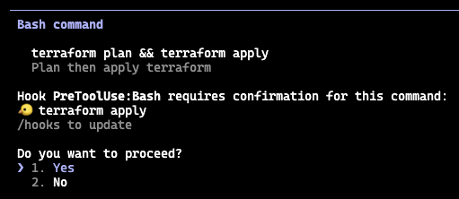
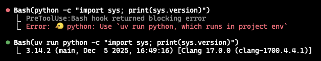
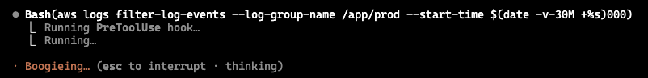
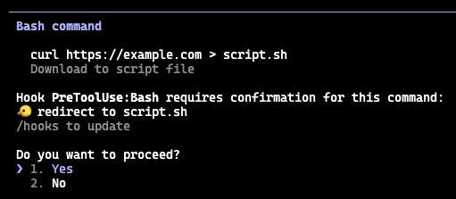

<p align="center">
  
</p>

<h1 align="center">🐤 Dippy</h1>
<p align="center"><em>Because <code>ls</code> shouldn't need approval</em></p>

---

<!-- FORK ENHANCEMENTS START -->
### 🍴 Fork Enhancements (vs [upstream](https://github.com/ldayton/Dippy))

- **Rust implementation (dippy-rs)** — branch `rust-port` ships `dippy` as one Rust binary (`just install-rs`, parsing with the Rable crate) that replaces the Python package; items marked *Python only* are not ported
- **File Edit/Read Approval** — `allow-edit`/`read`, `ask-edit`/`read`, `deny-edit`/`read` rules; a path through a symlink is allowed only when its target is allowed too (also for redirects), and `dippy check-rule KIND VALUE...` shows the rule that decides a path, web query or MCP tool
- **Read rules on shell arguments (dippy-rs)** — a `deny-read` or `ask-read` matching a literal argument that names an existing file (`cat .env`, `--file=.env`, after `cd`; `git show HEAD:.env` always; `git add|commit|rm|mv` never) denies or asks for the whole command, also over an `allow` command rule; missing files, grep patterns and messages pass, no match leaves the decision unchanged, and over SSH or a wrapper every word is checked with only flagged `allow-read` exceptions (best effort, see [File Operations](#file-operations))
- **Include directive** — `include <path-or-glob>` for composable config files
- **Exclusive config** — `DIPPY_CONFIG_ONLY` and `--config-only` isolate role-specific processes from user and project configuration
- **Context-aware rules** — `[flags]` syntax with `@subshell`, `@compound`, negation (`!`)
- **Scoped handler delegation** — `delegate [flags] command *` sends a matched command through its native safety handler instead of approving it outright, including per-target SSH context
- **Environment context flags** — `set context-env VAR` exposes an environment variable as the flag `[$VAR=value]`, so one config can hold per-agent rules across commands, output redirects, file edit/read operations, and web requests
- **Environment variables in rule patterns** — `allow-edit ${HCOM_DIR}/agents/${HCOM_INSTANCE_NAME}/**` expands `${NAME}` from Dippy's environment in every rule kind; values match literally, and an unset, empty or unsafe value disables the rule with a warning instead of widening it
- **Argument-aware command patterns (dippy-rs)** — a glob inside a pattern word matches one argument and `*` stops at `/`, so `allow rm tmp/*` never allows `rm tmp/a /etc/passwd`; a standalone `*` spans any arguments, and `allow rm -f tmp/**+` checks each of several paths; rules see the arguments Bash passes (quotes, escapes and `$'...'` removed, `{a,b}` expanded), and a symlink argument is also matched as its target, the stricter decision winning
- **Custom wrappers** — `wrapper <name>` for project-specific tools (ssh, docker exec, etc.), including literal quoted-heredoc script analysis with `--script-stdin`, two-word wrappers such as `cca run` with `--subcommand` (heredoc without a marker word: `--script-stdin -`), and output redirects validated by redirect rules
- **Option rules** — `allow-opt`, `ask-opt`, `deny-opt` for subcommand/flag control
- **Option-aware command patterns** — `[opts: -s, --header="Host: *"]` declares optional flags and single-value globs, with literal shell argument decoding and an exact positional argument count
- **Hash-pinned scripts (dippy-rs)** — `allow [sha256:HEX] ./scripts/build.sh *` (or `bash scripts/build.sh *`) allows a local script only while its content has that hash, otherwise asks; the user re-approves a changed script with `dippy trust scripts/build.sh`, which rewrites the hash in the project `.dippy` (or adds the rule for an executable script without one) and is denied to agents unless a rule allows it
- **WebSearch support** — auto-approval for WebSearch tool *(by tony)*
- **Approval dialog (`dippy-askpass`, dippy-rs)** — native window (eframe/egui; the same binary under that name) that shows the whole request read-only with the causes that asked, comes to the front without stealing keyboard focus, and saves an `allow` rule from its rule editor with a **Tags** field prefilled from the context flags; `Enter` allows, `Esc` denies
- **Tk Approval Provider (`dippy-askpass-gui`, Python only)** — standalone Tk GUI approval dialog with operation classification (Read File, Edit File, Command, Web Request, MCP Tool), single-key keyboard shortcuts (`y`/`Y`/`Enter` = allow, `n`/`N`/`Esc` = deny), and multi-monitor geometric centering via `xrandr`
- **Gemini CLI support** — integrated hook support for Gemini CLI tools
- **Pure Dippy Control (Gemini & AGY)** — YOLO mode automation via `dippy hooks setup-gemini-yolo` and AGY `--dangerously-skip-permissions` binary enforcement with askpass GUI resolution
- **Antigravity CLI (AGY) support** — native lifecycle hooks with project policy anchored by optional launch-provided `DIPPY_POLICY_CWD` or the standalone AGY workspace, so per-tool `Cwd` cannot select another project's `.dippy`
- **Codex CLI support** — native `hooks.json` integration for Codex `PreToolUse`/`PermissionRequest`/`PostToolUse` on `Bash`
- **Codex enforcement model** — `allow` auto-approves via `PermissionRequest`; `deny` hard-blocks via `exit 2`; `ask` falls back to Codex approval UI
- **Structured JSON output** — for PostToolUse hooks *(by tony)*
- **systemd handlers (dippy-rs)** — `systemctl` and `timedatectl` allow their read-only forms (`status`, `show`, `cat`, `is-*`, `list-*`, bare command; `timesync-status`, `list-timezones`) locally and over SSH or a wrapper; every other subcommand asks
- **SSH/sudo handlers** — remote context support for ssh and sudo commands; `docker exec` and `podman exec` pass `[docker, <container>]` / `[podman, <container>]` context flags
- **curl/wget writes through redirect rules (dippy-rs)** — both parse their arguments as the real tools do (bundled and abbreviated options), so every file they write (`-o`, `-O`, `--output-dir`, cookie jars, logs, traces) is checked against redirect rules; unknown output names, data sends, configs and `--expand-*` ask
- **`cp`/`mv` through redirect rules** — destinations (and `mv` sources, which get removed) are checked against `allow-redirect`/`ask-redirect`/`deny-redirect`, so `deny-redirect **/.dippy` also stops `mv .dippy /tmp/saved`
- **SQL command validation** — DuckDB, PostgreSQL, MySQL, SQLite, SQL Server, and Athena parse literal SQL with their own dialect, inspect nested operations and every statement, and ask when syntax or shell expansion makes the effects uncertain. Parenthesized queries and set-operation branches use the same checks, including DuckDB `USING SAMPLE` unions. Read-only casts handle dialect type aliases (such as DuckDB `VARCHAR`/`TEXT`) without mistaking normalization for discarded syntax; malformed queries and user-defined cast types require approval. MySQL/MariaDB executable comments and SQL Server `NEXT VALUE FOR` sequence increments require approval. DuckDB recognizes pure interval constructors, `stats` and `list_sum`; unknown and qualified functions require approval. DuckDB writes to the main database and verified single-file `COPY (SELECT ...) TO` CSV exports follow redirect rules, including exports under `-readonly` (see [SQL Databases](#sql-databases)). Export options support `HEADER`, `DELIMITER`, `QUOTE`, `ESCAPE`, `NULL` and `FORMAT CSV`; unsupported options, mixed export/database-write batches and extension commands require approval. Verified temporary table creation is allowed under `-readonly` or `-safe`. dippy-rs verifies query structure with the `sqlparser` crate against an allowlist of syntax and SQLGlot-known functions (Python uses SQLGlot), accepts `ATTACH` in DuckDB batches only as `ATTACH 'local.db' AS x (READ_ONLY)` (no `TYPE`, no remote path), additionally allows `duckdb -readonly` to run such an `ATTACH` before verified reads, lets `INSTALL`/`LOAD` of the function-only extensions `icu`, `inet`, `json` and `parquet` pass in any DuckDB batch (other extensions, paths and repositories ask), verifies DuckDB `read_text(path)`, `sqlite3` batches of read-only statements (also across SQL arguments) and SQLite date functions (`date`, `time`, `datetime`, `julianday`, `unixepoch`, `strftime`) with any number of modifiers, and `sqlite3` read-only introspection: `PRAGMA name` / `PRAGMA name(table)` for schema and status pragmas (never `=` or setters) and single-line `.schema`, `.tables`, `.indexes` and `.databases` with simple arguments.
- **Log rotation** — `set log-rotate-max-days N` for automatic cleanup
- **Notifier (Sidekick)** — `set notifier-command "CMD"` for external notifications (mail check). Supports long-polling via `--idle` in stop hooks. Use `set notifier-include "tool1, tool2"` to limit when it triggers.
- **Idle Prompt Notifications (Python only)** — `set idle-notifier-command "notify-send {title} {message}"` for notifications when Claude is waiting for input
- **Hook approvals log control** — `set log-hook-approvals off` to disable hook-approvals.log (Python only; dippy-rs writes no hook-approvals.log and ignores the setting)
- **Hybrid mode** — `set default pass` to let Claude decide unmatched commands
- **Audit log** — `cwd`, `agent`, and `suggestion` fields for better context; every entry is complete, with the full `command` and `suggestion` (`set log-full` is obsolete)
- **Grouped reasons** — a compound command lists each reason once, grouped by message (`sed, sha256sum: <message>`), for the agent and in the audit `cmd`
- **Audit log queries** — auto-approved read-only `dippy audit` filters the log and its rotations by date, decision, agent, cwd, tool, context flag (`--context-flag`) or text and counts entries with `--group-by`
- **Live dashboard** — `dippy dashboard` serves a read-only web view of the audit log (stdlib only, token-protected REST API in `docs/dashboard-api.json`, `127.0.0.1:8765` by default) to watch decisions across agents as they happen; `--hub NODES_FILE` shows the same page over many machines, with nodes added at runtime
- **Dashboard approvals (dippy-rs)** — `set approval dashboard` sends every `ask` of the agent hooks (Claude, AGY, Gemini, Cursor, Codex `PermissionRequest`, pi) and of `dippy run` to a queue on the local `dippy dashboard` node; you approve or deny in a popup laid out like `dippy-askpass` (with the rule editor) and the agent gets only allow or deny; a hub aggregates the queues of many machines. Fails closed: timeouts deny, and only a node that provably never got the request falls back to the normal prompt. See [Dashboard Approvals](docs/config.md#dashboard-approvals-dippy-rs)
- **CLI mode** — standalone command validation with `--cmd`, `--stdin`, `--json`, `--remote`
- **Approved execution** — `dippy run` classifies a quoted argument or literal quoted-heredoc script and runs it locally only after an `allow` or an approved `ask` (remote execution belongs to the caller's `wrapper`; `run-on-server` was removed in 0.6.0)
- **Multi-Agent Support** — dedicated modes for Claude, Gemini, Antigravity CLI (AGY), Cursor (`preToolUse`), pi-mono, Moltbot, Codex, Windsurf, PearAI
- **Fail-closed config errors (dippy-rs)** — an invalid `set` line or other config error denies every tool call in every hook mode and in `--cmd`, naming the file and line, until the config is fixed
- **pi-mono extension** — TypeScript extension for [pi-mono](https://github.com/badlogic/pi-mono) AI assistant
- **Python `-c` AST analysis** — `python -c 'code'` is statically analyzed for safety instead of always requiring confirmation. Safe code (no I/O, no dangerous imports) is auto-approved *(design by nickdaview)*
- **Configurable Python modules** — `python-allow-module` and `python-deny-module` directives to customize which modules are safe or dangerous during `-c` analysis, plus `python-allow-symbol sys.stdin` to allow a single name from a module that is otherwise too broad to trust *(design by nickdaview)*
- **CLI management** — `dippy hooks install/uninstall/list` and `dippy doctor` diagnostics
- **Configuration administration** — `dippy config get/set/unset [--user|--project]` edits settings in place, and `dippy config add-rule [--user|--project] RULE` appends a rule line
<!-- FORK ENHANCEMENTS END -->

---

> **Stop the permission fatigue.** Claude Code asks for approval on every `ls`, `git status`, and `cat` - destroying your flow state. You check Slack, come back, and your assistant's just sitting there waiting.

Dippy is a shell command hook that auto-approves safe commands while still prompting for anything destructive. When it blocks, your custom deny messages can steer Claude back on track—no wasted turns. Get up to **40% faster development** without disabling permissions entirely.

Built on [Parable](https://github.com/ldayton/Parable), our own hand-written bash parser—no external dependencies, just pure Python. 14,000+ tests between the two.

***Example: rejecting unsafe operation in a chain***



***Example: rejecting a command with advice, so Claude can keep going***



## ✅ What gets approved

- **Complex pipelines**: `ps aux | grep python | awk '{print $2}' | head -10`
- **Chained reads**: `git status && git log --oneline -5 && git diff --stat`
- **Cloud inspection**: `aws ec2 describe-instances --filters "Name=tag:Environment,Values=prod"`
- **Container debugging**: `docker logs --tail 100 api-server 2>&1 | grep ERROR`
- **Safe redirects**: `grep -r "TODO" src/ 2>/dev/null`, `ls &>/dev/null`
- **Command substitution**: `ls $(pwd)`, `git diff foo-$(date).txt`



## 🚫 What gets blocked

- **Subshell injection**: `git $(echo rm) foo.txt`, `echo $(rm -rf /)`
- **Subtle file writes**: `curl https://example.com > script.sh`, `tee output.log`
- **Hidden mutations**: `git stash drop`, `npm unpublish`, `brew unlink`
- **Cloud danger**: `aws s3 rm s3://bucket --recursive`, `kubectl delete pod`
- **Destructive chains**: `rm -rf node_modules && npm install` (blocks the whole thing)



---

## ⚠️ Known Limitations

**Subagents ignore PreToolUse hook decisions** - Claude Code subagents (spawned via Task tool) do not respect `allow`/`deny` decisions from PreToolUse hooks. Even when Dippy returns `"permissionDecision": "allow"`, subagents will still prompt for approval.

- **Cause:** Known bug in Claude Code ([#4740](https://github.com/anthropics/claude-code/issues/4740), [#4669](https://github.com/anthropics/claude-code/issues/4669))
- **Status:** Closed as "not planned" by Anthropic (January 2026)
- **Impact:** Hooks work correctly in main sessions but are ignored in subagents
- **Workaround:** Use explicit config rules instead of relying on hook decisions

See [docs/subagent-hook-issues.md](docs/subagent-hook-issues.md) for detailed analysis.

---

## Installation

### Quick Install (from source)

```bash
# Clone the repository
git clone https://github.com/orgoj/Dippy.git
cd Dippy

# Install via uv tool (recommended)
uv tool install .

# Verify installation
dippy --version
```

**Note:** Make sure `~/.local/bin` is on your PATH.

### Development Mode

```bash
uv pip install -e .
```

---

## Quick Start

The easiest way to configure Dippy is using the CLI commands:

### 1. Install Hooks

```bash
# Install for Claude Code (global)
dippy hooks install claude --global

# Install for Gemini CLI (global)
dippy hooks install gemini --global

# Install for Cursor IDE (global)
dippy hooks install cursor --global

# Install for Windsurf (global)
dippy hooks install windsurf --global

# Install for Codex CLI (global; configures hooks and approval policy)
dippy hooks install codex --global
```

### 2. Verify Installation

```bash
# Check hook status
dippy hooks list

# Run diagnostics
dippy doctor
```

That's it! Dippy is now configured and will auto-approve safe commands.

### Manual Configuration (Advanced)

If you prefer manual configuration or need project-specific settings:

**Claude Code** - add to `~/.claude/settings.json`:
```json
{
  "hooks": {
    "PreToolUse": [
      {
        "matcher": "Bash|Write|Edit|MultiEdit|Read|LS|Glob|Grep|Search|WebSearch|mcp__.*",
        "hooks": [{ "type": "command", "command": "dippy" }]
      }
    ],
    "PostToolUse": [
      {
        "matcher": "Bash|WebSearch|mcp__.*",
        "hooks": [{ "type": "command", "command": "dippy" }]
      }
    ]
  }
}
```

**Gemini CLI** - add to `~/.gemini/settings.json`:
```json
{
  "hooks": {
    "BeforeTool": [
      {
        "matcher": "run_shell_command|write_file|replace|read_file|google_web_search",
        "hooks": [{ "type": "command", "command": "dippy --gemini" }]
      }
    ],
    "AfterTool": [
      {
        "matcher": "run_shell_command|google_web_search",
        "hooks": [{ "type": "command", "command": "dippy --gemini" }]
      }
    ]
  }
}
```

**Codex CLI** - `dippy hooks install codex --global` manages both files. The
required `~/.codex/config.toml` settings are:

```toml
approval_policy = "on-request"

[features]
hooks = true
```

`approval_policy = "never"` is incompatible with execpolicy `prompt` rules:
Codex rejects the command before emitting `PermissionRequest`, so Dippy cannot
approve it. The installer repairs this setting idempotently, and `dippy doctor`
reports incompatible configurations.

The corresponding `~/.codex/hooks.json` entries are:
```json
{
  "hooks": {
    "PreToolUse": [
      {
        "matcher": "^Bash$",
        "hooks": [{ "type": "command", "command": "dippy --codex" }]
      }
    ],
    "PermissionRequest": [
      {
        "matcher": "^Bash$",
        "hooks": [{ "type": "command", "command": "dippy --codex" }]
      }
    ],
    "PostToolUse": [
      {
        "matcher": "^Bash$",
        "hooks": [{ "type": "command", "command": "dippy --codex" }]
      }
    ]
  }
}
```

**Current Codex behavior:** Dippy auto-approves allowed shell commands in the
`PermissionRequest` hook, but Codex only emits that event when its own policy
already requires approval. `PreToolUse` cannot force a prompt: an `ask` there
is advisory and otherwise fails open. For an external wrapper that can change
state outside the sandbox, add a Codex execpolicy prompt rule so every wrapper
invocation reaches `PermissionRequest`:

```python
prefix_rule(
    pattern = ["cca-tmux-cli"],
    decision = "prompt",
    justification = "Let Dippy decide whether this remote command requires user approval.",
)
```

Put global rules in `~/.codex/rules/*.rules` or project rules in
`.codex/rules/*.rules`, then restart Codex. Prefer Dippy's own stable execution
surface for external commands: prompt `dippy run` in the agent policy, then let the inner Dippy invocation enforce the command rules.
See [Codex CLI hooks](docs/hook-systems/codex-cli.md).

**Current Gemini behavior:** Gemini CLI 0.42 treats `BeforeTool` hook `allow` as "continue to normal policy" by default. To enable **Pure Dippy Control** and avoid double prompts, use:
```bash
dippy hooks setup-gemini-yolo
```
This enables Gemini's native YOLO mode, trusting Dippy as the primary authority.

**Codex sandbox gotcha:** During Codex `workspace-write` tool execution on Linux, `.codex` can appear inside the sandbox as a synthetic read-only file-like path even when the host workspace does not contain a normal `.codex` file. That artifact comes from Codex sandbox path protection, not from Dippy.

**Hooks installed:**
- **PreToolUse**: Validates tools BEFORE execution (Bash, file ops, WebSearch, MCP)
- **PostToolUse**: Shows feedback messages AFTER execution (for `after` directive)

Changing hook config requires restarting the agent session. For Codex, both `hooks.json` and `config.toml` are loaded at session start.

---

## CLI Commands

### Approved Execution

```bash
dippy run 'CMD'
dippy run <<'DIPPY'               # literal multiline local script
CMD
DIPPY
```

The command runs locally with Bash in the current directory. See
[the configuration reference](docs/config.md#direct-execution) for askpass,
config-management setup, and the interaction between approval and agent CLI
timeouts. Projects with a supervising agent or a custom
user channel can set `approval-wait-message` without exposing the underlying
enforcement mechanism.

### Hooks Management

```bash
dippy hooks list                    # Show hook status for all agents
dippy hooks install <agent>         # Install hooks (project-local)
dippy hooks install <agent> --global  # Install hooks (global)
dippy hooks uninstall <agent>       # Remove hooks (project-local)
dippy hooks uninstall <agent> --global  # Remove hooks (global)
```

**Supported agents:** `claude`, `gemini`, `cursor`, `windsurf`, `codex`

**Status indicators:**
- `+` = installed
- `?` = legacy (old `dippy-hook` detected)
- ` ` = not installed

**Scopes:**
- **Project-local** (default): `.claude/settings.json`, `.cursor/hooks.json`, `.gemini/settings.json`, `.codex/hooks.json`
- **Global** (`--global`): `~/.claude/settings.json`, `~/.cursor/hooks.json`, `~/.gemini/settings.json`, `~/.codex/hooks.json`

### Diagnostics

```bash
dippy doctor                        # Run all health checks
dippy doctor --agent claude         # Check specific agent
dippy doctor --verbose              # Show detailed diagnostics
```

**Health checks:**
- ✓ Installation (on PATH, version check)
- ✓ Hook status per agent (Claude, Gemini, Cursor, Windsurf, Codex, pi-mono)
- ✓ Codex `hooks` feature flag validation
- ✓ Legacy hook detection with full path
- ✓ pi_wrapper check for pi-mono/moltbot
- ✓ Configuration validation (syntax errors)
- ✓ Log health: the audit log (`set log`, default `~/.dippy/audit.log`) — writable directory, size warning (Python also checks the agents' `hook-approvals.log` directories)

**Exit codes:** `0` (OK), `1` (warnings), `2` (critical issues)

### CLI Mode

Validate commands without running as a hook:

```bash
dippy --cmd 'rm -rf /'              # validate a command
dippy --cmd 'ls -la' --json         # JSON output
dippy --cmd 'git status' --cwd /path
echo 'ls -la' | dippy --stdin       # read command from stdin
```

**Options:**
- `--cmd COMMAND` — command to validate
- `--stdin` — read command from stdin
- `--cwd PATH` — working directory
- `--json` — output as JSON
- `--config PATH` — custom config file
- `--config-only PATH` — load only this config, skipping user and project config
- `--agent NAME` — force agent name in audit log (default `cli`)
- `--remote` — skip local path checks
- `--version` — show version

---

## Supported Agents

Dippy adapts its output format and behavior based on the agent:

| Agent | Flag | Env Var | Hook Support |
|-------|------|---------|--------------|
| Claude Code | `--claude` | `DIPPY_CLAUDE=1` | ✅ |
| Gemini CLI | `--gemini` | `DIPPY_GEMINI=1` | ✅ |
| Cursor IDE | `--cursor` | `DIPPY_CURSOR=1` | ✅ `preToolUse` |
| Windsurf | `--windsurf` | `DIPPY_WINDSURF=1` | ✅ |
| pi-mono | `--pi` | `DIPPY_PI=1` | extension |
| Moltbot | `--moltbot` | `DIPPY_MOLTBOT=1` | extension |
| OpenAI Codex | `--codex` | `DIPPY_CODEX=1` | ✅ |
| PearAI | `--pearai` | `DIPPY_PEARAI=1` | partial |

Python Dippy keeps an approval log per agent mode (e.g., `~/.claude/hook-approvals.log`). dippy-rs writes none; every hook call writes at least one entry to the audit log instead.

---

## Configuration

Dippy reads config from `~/.dippy/config` (global) and `.dippy` (project).

### Basic Rules

```bash
# Allow safe commands
allow git status
allow ls *
allow cat *

# Block dangerous commands
deny rm -rf *
deny docker rm *

# Prompt with message
deny pip install "Use uv pip install instead"
deny python "Use uv run python"
```

### File Operations

Auto-approve file operations using the same config:

```bash
allow-read src/**
allow-edit src/**
deny-read **/.env*
deny-edit **/.env*
ask-edit **/config.*
```

In dippy-rs `deny-read` and `ask-read` also filter the path arguments of shell
commands, on top of the command rules: `cat .env`, `cat -- .env`,
`zorp --file=.env` and `git show HEAD:.env` are denied by `deny-read **/.env*`
even when `allow cat *` matches. Candidates are literal non-option words
(after Bash quote removal and `~` expansion), `--opt=value` and `-fVALUE`
values, every word after `--`, and input redirect targets (`cat < .env`),
resolved against the cwd after `cd`, that name an existing file; a missing file
cannot be read, so grep patterns and commit messages (`grep -rn credentials
src/`) pass, as do words longer than the file-name limit (long messages). The path of `git show rev:path` and `git cat-file -p rev:path` is
always checked, also with git global options and behind wrappers such as
`timeout`. `git add`, `git commit`, `git rm` and `git mv` stage files without
printing them and skip this filter, so an encrypted secret can be committed
while `cat` or `git diff` of it stays denied. A single `cd` moves the cwd of the commands after it; a command
with several `cd` (`cd a && cd b`, `cd a || cd b`) is denied. A later
`allow-read **/.env.example` exempts that file; `allow-read` is never required
for an argument, and a path without a matching read rule leaves the command
decision unchanged. Over SSH or a wrapper the server's files are unknown, so
every literal word is checked and only `allow-read` rules with a remote context
flag apply (`allow-read [ssh] /**` trusts every server read).

This filter is best effort. It does not see paths built at runtime
(`cat $(echo .env)`, `cat "$F"`, globs such as `cat .env*`, a script opening
the file itself), files created or replaced after the check (`ln -s .env l &&
cat l`), or the files below a directory argument (`grep -r KEY .`). A search
term or metadata operand that names an existing protected file is treated as a
read: with `.env` present, `rg -F '.env' README.md` and `ls -l .env` are denied.

### SQL Databases

SQL clients pass only literal SQL that Dippy verifies as read-only; anything
uncertain asks. Changes to data or structure differ by client:

| Client | Read-only SQL | Data or schema change |
|---|---|---|
| `psql`, `mysql`, `sqlcmd`, `aws athena start-query-execution` | allow | always ask |
| `sqlite3 FILE` | allow | always ask |
| `duckdb FILE` | allow | redirect rules for `FILE` |
| `duckdb` without a database file | allow | always ask |

DuckDB treats a verified change of the main database file (`CREATE`,
`INSERT`, `UPDATE`, `DELETE`, `DROP TABLE`, `ALTER TABLE ... ADD COLUMN`) as a
write to that file, so a broad `allow-redirect ./**` or `tmp/**` also lets the
agent change every DuckDB database below it. Any other write statement asks as
`duckdb (unverified database write)`. Single-file `COPY (SELECT ...) TO 'f.csv'`
exports follow redirect rules for `f.csv`.

```bash
# DuckDB: read-only everywhere, writes only to one scratch database
ask-redirect **/*.db "Database changes need approval; use read-only queries."
ask-redirect **/*.duckdb "Database changes need approval; use read-only queries."
allow-redirect tmp/work.db
```

Redirect rules cannot tell a schema change from a data change; both count as
writing the file.

### Advanced Features

```bash
# Include external config files
include ~/.dippy/shared-rules
include .dippy-local-*

# Log settings
set log ~/.dippy/audit.log
set log-rotate-max-days 30
set log-hook-approvals off

# Default behavior
set default ask                    # prompt (default)
# set default pass                 # let Claude decide
# set default allow                # auto-approve

# Context-aware rules
deny [!@subshell] cd *              # deny cd outside subshell
allow [@subshell] cd *              # allow (cd x && y)

# Custom wrappers
wrapper docker-exec
allow [docker-exec,prod] read *

# Option rules
allow-opt git status fetch log diff
deny-opt "git push" --force "Use --force-with-lease"

# MCP tools
allow-mcp mcp__github__get_*
deny-mcp mcp__*__delete_*

# After hook
after git commit * "Check project-tasks.md"
```

**Full documentation:** [docs/config.md](docs/config.md)

---

## Troubleshooting

### Not working?

```bash
# Run diagnostics
dippy doctor

# Check hook status
dippy hooks list

# Reinstall hooks
dippy hooks uninstall claude --global
dippy hooks install claude --global
```

### Check logs

- Dippy audit: `set log` path, default `~/.dippy/audit.log` (`dippy audit`); config warnings: `dippy doctor`
- Python Dippy only: `~/.claude/hook-approvals.log`, `~/.gemini/hook-approvals.log`

### Common Issues

- **Hook not triggering** → Run `dippy doctor` to diagnose
- **JSON syntax errors** → Check config with `dippy doctor`
- **Legacy hook detected** → Run `dippy hooks install <agent> --global`
---

## Uninstall

```bash
# Remove hooks
dippy hooks uninstall claude --global
dippy hooks uninstall gemini --global

# Uninstall tool
uv tool uninstall dippy
```

---

## pi-mono Extension

Dippy includes a TypeScript extension for [pi-mono](https://github.com/badlogic/pi-mono):

```bash
# Link the extension
ln -s /path/to/dippy/pi-extension/dippy-extension.ts \
      ~/.pi/agent/extensions/dippy-extension.ts
```

Uses your existing `~/.dippy/config` and `.dippy` files. The extension runs
`dippy --pi`, which needs the Rust `dippy` (`just install-rs`); see
[pi-extension/README.md](pi-extension/README.md).

---

## Development

```bash
# Install in development mode
uv pip install -e .

# Run tests
uv run python -m pytest

# Run specific test
uv run python -m pytest tests/test_agents.py -v
```

---

**Full documentation:** [docs/config.md](docs/config.md)
**Upstream repository:** [ldayton/Dippy](https://github.com/ldayton/Dippy)
